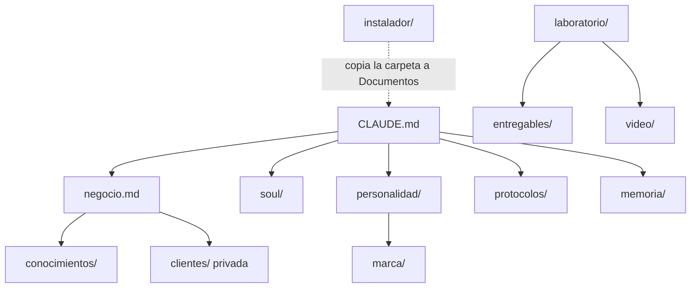

# Grafo · mapa de la carpeta

`instalador/` (Mac y Windows) instala las herramientas y copia esta carpeta a `Documentos/Claude Code Clarity` sin sobrescribir nada.

Se actualiza al cerrar la entrevista y cuando se agregan carpetas nuevas.
